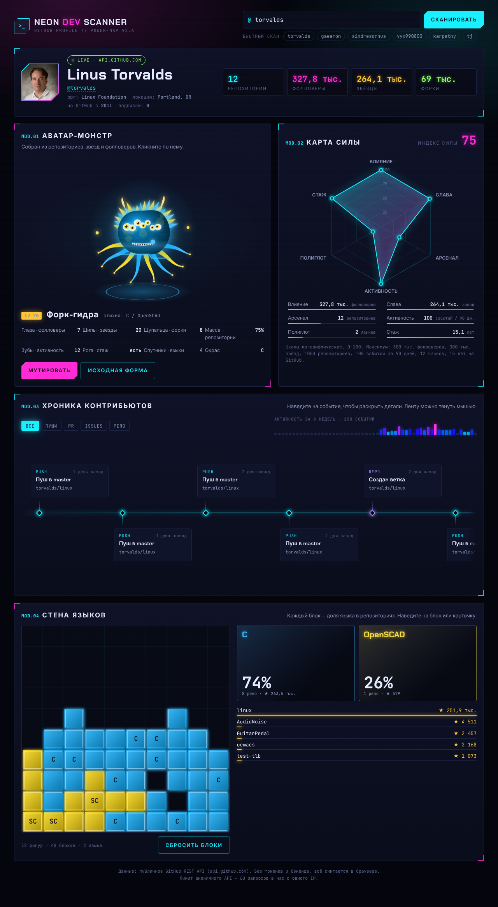

# Neon Dev Scanner

Киберпанк-дашборд для любого GitHub-профиля. Введи никнейм и получи процедурного монстра, радар «силы» разработчика, неоновую хронику контрибьютов и тетрис из языков программирования.

Один HTML-файл: никакой сборки, фреймворков и зависимостей. Только ванильный JS, Canvas 2D и публичное GitHub API.



## Фичи

### Аватар-монстр
Каждый профиль порождает своего уникального монстра. Внешность генерируется из статистики:

| Черта | Источник |
| --- | --- |
| Глаза | фолловеры |
| Шипы | звёзды |
| Щупальца | форки |
| Размер тела | число репозиториев |
| Зубы | активность за 90 дней |
| Рога | стаж на GitHub |
| Окрас | главный язык |
| Спутники | количество языков |

Монстр дышит, моргает и следит глазами за курсором. По клику он рычит и разбрасывает искры. Кнопка «Мутировать» перебрасывает генетику, а «Исходная форма» возвращает оригинал. Генерация детерминированная: один и тот же никнейм всегда даёт одного и того же монстра.

### Карта силы
Радар по шести осям: **Влияние**, **Слава**, **Арсенал**, **Активность**, **Полиглот**, **Стаж**. Шкалы логарифмические, иначе `torvalds` с его сотнями тысяч фолловеров просто не влез бы в график. Из среднего по осям считается общий индекс силы 0–100. Он же задаёт уровень и класс монстра: от «Бит-личинки» до «Архонта ядра».

### Хроника контрибьютов
Горизонтальная лента последних публичных событий: пуши, PR, issues, звёзды, релизы, новые ветки.
- карточки плавно увеличиваются и раскрывают детали при наведении;
- фильтры по типу событий;
- полоса активности за последние 8 недель;
- ленту можно тянуть мышью или крутить колесом.

### Стена языков
Вместо скучного пирога здесь стакан тетриса. Каждая фигура — кусочек языка, и чем популярнее язык в репозиториях, тем больше его фигур. Блоки падают с отскоком, укладываются по простой тетрис-эвристике, а в конце по стакану проходит скан-линия. Рядом неоновые карточки с 3D-наклоном за курсором. Наведение на блок подсвечивает карточку языка, и наоборот.

## Запуск

Просто открой `index.html` в браузере. Для GitHub Pages: **Settings → Pages → Deploy from branch**, корень репозитория.

Если нужен локальный сервер:

```bash
python3 -m http.server 8000
# → http://localhost:8000
```

## Данные

Используются три эндпоинта публичного GitHub REST API, токен не нужен:

- `GET /users/{login}`
- `GET /users/{login}/repos?per_page=100&sort=pushed`
- `GET /users/{login}/events/public?per_page=100`

Анонимный лимит — 60 запросов в час с одного IP, а один скан тратит 3 запроса. Если API недоступно (лимит или нет сети), показывается встроенный демо-снимок профиля `torvalds` с примерными цифрами.

GitHub отдаёт публичные события только за последние 90 дней. Если событий мало, хроника дополняется последними обновлёнными репозиториями.

## Стек

- HTML + CSS (кастомные свойства, `color-mix`, анимации, `clip-path`)
- Canvas 2D: монстр, радар, тетрис
- Шрифты [Chakra Petch](https://fonts.google.com/specimen/Chakra+Petch) и [JetBrains Mono](https://fonts.google.com/specimen/JetBrains+Mono)
- Учитывается `prefers-reduced-motion`, вёрстка адаптивная до 360px

## Лицензия

MIT
